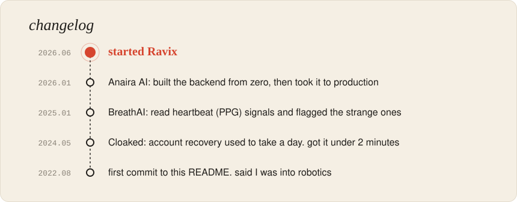

### hey, I'm Rushabh 👋

Back in 2024, this README called me an "entrepreneur in the making". Took a little while, but I'm now building **[Ravix](https://ravix.sh)**.

Ravix puts your coding agent on a cloud machine. Close your laptop and it keeps working. When it's done, you send your teammate the running app instead of a giant diff, and they can prompt the same agent with all the context still there.

 

 

### side quests

[**Insurance GPT**](https://github.com/RushabhSingwi/Insurance-RAG-chatbot) reads insurance policies so you don't have to. It scores 0.96 on faithfulness, which means it mostly sticks to what the policy actually says.

[**Muscles**](https://muscles.lovable.app/) is a no-fuss log for workouts and meals.

### tools

Mostly Python. Django when it's a product, FastAPI when it's just an API, Postgres and Redis underneath, and Celery or SQS for anything that can happen later.

 

<i>Curious about Ravix, or want to talk agents, backends or RAG?</i> <a href="mailto:rushabhsingwi@gmail.com">Email me</a> or find me on <a href="https://www.linkedin.com/in/rushabh-singwi-4917b0225/">LinkedIn</a>.

